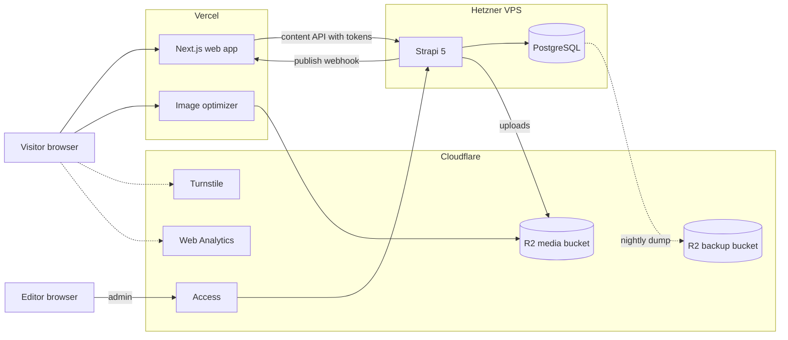
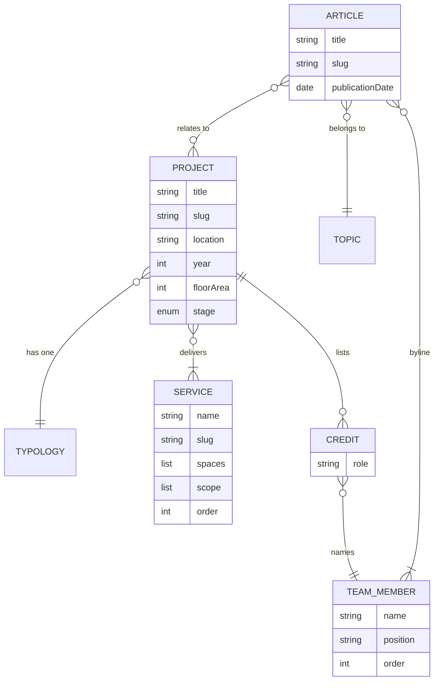
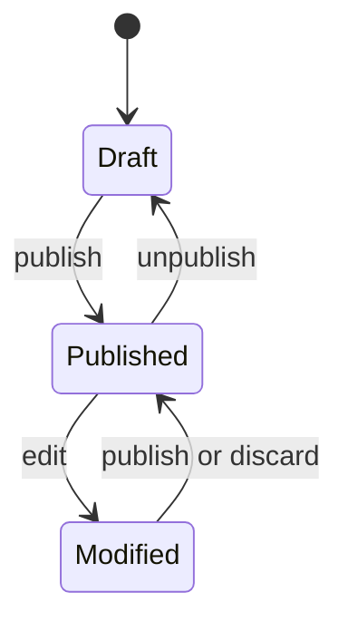
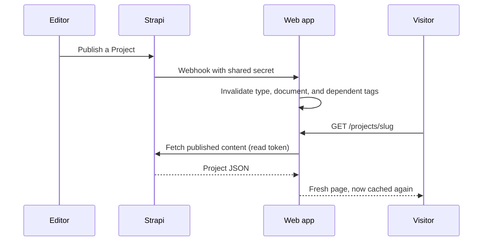
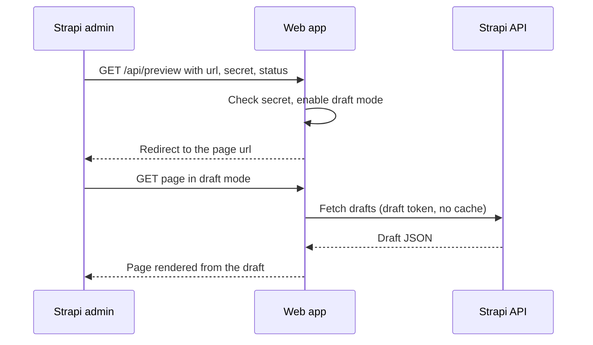
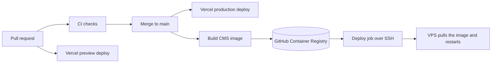
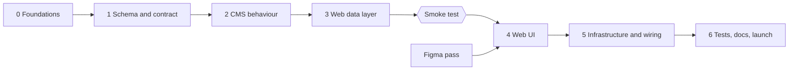

# Eaves Website Design

This document records how the Eaves website and its CMS are built and run.
It collects every decision from the design interview of 2026-11-04.
The domain language lives in [GLOSSARY.md](../GLOSSARY.md), and capitalized terms here (Project, Service, Block, Editor, and so on) mean exactly what the glossary says.
The three decisions most likely to surprise a future reader have their own records:

- [ADR 0001: Hybrid page model instead of a page builder](adr/0001-hybrid-page-model.md)
- [ADR 0002: Fictional content policy](adr/0002-fictional-content-policy.md)
- [ADR 0003: Ready for more languages from day one, English only at launch](adr/0003-locale-ready-english-only.md)

## 1. Goals

The site is a portfolio piece: a live public website plus a public repository, aimed at employers and freelance clients reviewing the developer's work.
It presents Eaves, a fictional Bangkok studio, through its Services, Projects, and Articles.
Editors manage every piece of content, including navigation, the Home page, and site-wide text, without touching code.
Publishing reaches the live site within seconds and never needs a redeploy.
The site must look like a real studio's website while never claiming real work, real people, real licences, or real contact details (ADR 0002).

### Not in v1

- Thai content; the structure is ready for it (ADR 0003).
- A free-form page builder (ADR 0001).
- CMS access for reviewers; a screen recording on the About this demo page shows the editing experience instead.
- Careers, Awards, and Press.
- Site-wide search.
- Automatic emails of any kind, including CMS password resets.
- A staging environment.
- Paid Strapi features (Live Preview, Releases, Content History, Review Workflows).

## 2. The Studio

Eaves is a small Bangkok studio of about ten people offering architectural and interior design services, mostly residential and small commercial work, with a quiet, material-led tone.
The name refers to the overhanging roof edge that keeps walls cool and monsoon rain off the windows, a quiet statement that the Studio designs for its climate.
The Studio designs only: it claims no professional licence and provides no engineering, construction, or construction management.
The Services page heading reads "Design services".

| Service | Spaces | Scope |
| --- | --- | --- |
| Residential Interior Design | Houses, condominiums, private residences | Space planning, interior concepts, 3D visualization, material and furniture selection, design documentation |
| Commercial Interior Design | Cafes, restaurants, retail stores, showrooms, customer-facing spaces | Brand-inspired interiors, customer flow, space planning, design development |
| Architectural Design | New residential and small commercial buildings | Concept development, site and spatial planning, architectural drawings, design coordination |
| Workplace Design | Offices and professional work environments | Workplace planning, meeting and collaboration areas, lighting and acoustic considerations, furniture and material specifications |
| Renovation & Space Planning | Existing residential and commercial spaces | Existing-space assessment, layout improvements, renovation concepts, material and finish recommendations |

Design coordination means working with the engineers and contractors the client appoints.
Every Project has exactly one Typology: Residential, Commercial, or Workplace.

## 3. Stack

| Concern | Choice |
| --- | --- |
| Web app | Next.js 16 (App Router), React, TypeScript in strict mode |
| Styling | Tailwind CSS 4; shadcn/ui only for behaviour primitives such as the mobile navigation sheet, dialogs, carousel, and form controls |
| CMS | Strapi 5 Community Edition |
| Database | PostgreSQL |
| Media storage | Cloudflare R2 through Strapi's official S3 upload provider; MinIO locally |
| Package manager | pnpm workspace with the default isolated linker; Strapi 5 builds and boots without `node-linker=hoisted` |
| Local infrastructure | Docker Compose |
| Runtime | The newest Node LTS that Strapi supports when the project is scaffolded |

## 4. Repository layout

```text
eaves/
├── apps/
│   ├── web/              Next.js site
│   └── cms/              Strapi 5, including seed/ with versioned seed content
├── packages/             shared configuration (TypeScript, lint)
├── docs/
│   ├── DESIGN.md
│   └── adr/
├── docker-compose.yml    Postgres and MinIO for local development
├── GLOSSARY.md
├── .gitattributes        forces LF line endings
├── .gitignore
└── .nvmrc                pins the Node version for local development and CI
```

The code is MIT licensed.
The README states that the Eaves name, its copy, and its images are not licensed for reuse.

## 5. System overview



Visitors only ever talk to Vercel and Cloudflare.
The web app reads content from Strapi on the server side with API tokens, so the content API stays closed to the public.
Editors reach the Strapi admin only through Cloudflare Access.

## 6. Hosting and environments

There are exactly two environments: local and production.

| | Local | Production |
| --- | --- | --- |
| Web app | `pnpm dev` | Vercel Hobby at `eaves.layaungphyo.dev` |
| CMS | Strapi in development mode | Strapi in a Docker image on a Hetzner VPS at `cms.eaves.layaungphyo.dev` |
| Database | Postgres in Compose | Postgres in Compose on the VPS |
| Media | MinIO in Compose | R2 at `media.eaves.layaungphyo.dev` |

Vercel builds a preview deploy for every branch, and those previews read production's published content with the same read-only token, so design changes are reviewed against real content.
Content type changes are proven locally and in CI before they reach production.

### Domains and DNS

R2 custom domains require the domain to be a zone in the same Cloudflare account, and the partial (CNAME) setup is a Business plan feature.
So the nameservers of `layaungphyo.dev` move from Name.com to Cloudflare, while Name.com stays the registrar.
Before the move, every existing record is recreated in Cloudflare as DNS only: the GitHub Pages A and AAAA records, the `www` CNAME, the GitHub verification TXT record, and the MX records.
The portfolio site at `layaungphyo.dev` and its email keep working throughout.
`layaungphyo.dev` was registered through the GitHub Student Pack and renews on 2027-10-09; the demo's URLs depend on that renewal.

### The VPS

The VPS runs the smallest Hetzner shared plan in Germany or Finland, with Strapi, Postgres, and Caddy under Docker Compose.
The 200 ms or so between Bangkok and Europe only affects the CMS admin, because visitors get the site from Vercel's CDN.
The admin panel is built in CI, not on the server, so the small plan is enough.
`cms.eaves.layaungphyo.dev` is proxied through Cloudflare, and the VPS firewall accepts web traffic only from Cloudflare's IP ranges, so nobody can reach Strapi around Cloudflare Access by using the server's IP address.
Caddy terminates TLS with a Cloudflare Origin CA certificate, and Cloudflare's SSL mode is Full (strict).

### Costs

| Service | Cost | Notes |
| --- | --- | --- |
| Vercel Hobby | Free | Allowed because the demo is non-commercial; 5,000 image transformations a month |
| Hetzner VPS | About €6 a month including IPv4 | Prices rose in June 2026; the plan line has had stock gaps |
| Cloudflare R2 | Free up to 10 GB of Standard storage, free egress | Sources disagree on whether activating R2 needs a payment method |
| Cloudflare Access, Turnstile, Web Analytics | Free | Access is free for teams under 50 users |
| Domain | Already owned | Renews 2027-10-09 |

### Checks before any signup

The developer is a student paying with their own card, and some countries and cards trigger larger holds or prepayments than generic docs describe.
Before each signup, the Thailand-specific rules are checked first:

- Hetzner: verify the account by passport and selfie through iDenfy rather than by card prepayment; new accounts are reviewed by hand.
- Cloudflare R2: confirm whether a payment method is required and what a Thai card is charged when it is added.

## 7. Content model



Blocks and Sections are parts inside a document rather than records of their own, so the diagram leaves them out: Projects, Articles, Services, and Pages have a body of Blocks, and the Home page and Studio page arrange Sections.

### Content types

| Type | Kind | Fields |
| --- | --- | --- |
| Project | Collection | Title, slug, one-line summary, cover image, body of Blocks, Typology, one or more Services, location (neighbourhood and city), year, floor area in m², stage (Completed, Under construction, Concept), Credits, SEO |
| Service | Collection | Name, slug, one-line summary, cover image, Spaces, Scope, optional body of Blocks, order, SEO |
| Typology | Collection | Name, slug |
| Team Member | Collection | Name, Position, portrait, two or three sentence bio, order |
| Article | Collection | Title, slug, excerpt, cover image, body of Blocks, Byline (one or more Team Members), Topic, related Projects, Publication date, SEO |
| Topic | Collection | Name, slug |
| Page | Collection | Title, slug, body of Blocks, SEO |
| Home page | Single | Sections, SEO |
| Studio page | Single | Sections, SEO |
| Site Settings | Single | Contact details, social links, header navigation, footer navigation, Demo Notice text, not-found text, default SEO text and share image |
| Inquiry | Collection | Name, email, kind (New project, Press, Other), message, consent; the received time is Strapi's own creation time |
| Slug history | Collection | Old path, and the type and document ID of the document it now points to |

The Project field is called stage rather than status, because Strapi reserves `status` on any type with Draft and Publish.
Slug history stores the target as a type and a document ID rather than a relation, because the target can be a Project, Article, Service, or Page.
A Service page lists its Projects automatically, from the Projects that name it.
The Projects list is sorted by year, newest first.
Projects have no client field, and Credits name only Team Members (ADR 0002).
Positions and Credit roles use designer titles such as Design Director, Architectural Designer, Interior Designer, and Lead Designer, never "Registered Architect".
Team Members have no email, phone, or social links, because the people are fictional.

### Blocks

Text, Image, Image pair, Gallery, Quote, and Drawing.
A Drawing shows a plan, section, or elevation uncropped on a plain background with a caption, and opens full screen when tapped.

### Sections

One shared catalogue serves both the Home page and the Studio page:

- Statement: large text with an optional image.
- Selected Projects: an Editor picks three to six Projects.
- Services overview.
- Latest Articles: the newest three, chosen automatically.
- Studio introduction: text, image, and a link to the Studio page.
- Team: all Team Members in the order the Editor sets.
- Figures: a few numbers, such as years in practice.
- Contact prompt.

### SEO fields

Every type with a URL has an SEO group: meta title, description, and share image.
Empty fields fall back to the defaults in Site Settings.

### Draft and Publish

Draft and Publish is on for Project, Service, Team Member, Article, Page, Home page, Studio page, and Site Settings.
It is off for Typology, Topic, Inquiry, and Slug history, which are reference data or records rather than editorial content.
Strapi 5 checks required fields only on publish, so a draft can be missing fields that its published version always has.



Authors work only inside Draft; only Editors move a document to Published.

### Localization

Strapi's internationalization is on for every content type except Inquiry and Slug history, with English as the only locale (ADR 0003).
Each field is marked now, because Strapi stores the choice with the field's definition:

| Per language | Shared across languages |
| --- | --- |
| Titles, names, slugs, summaries, excerpts, bodies, Spaces, Scope, Position, bios, Credits, location text, SEO text, Sections, Site Settings, and every link between entries (Typology, Services, Byline, Topic, related Projects) | Year, floor area, stage, cover images and portraits, order, Publication date |

Strapi localizes a component, a body of Blocks, or a list of Sections as a whole, so images inside a body belong to its language.
For the same reason Credits, both who is credited and their role, are per language, and a translation copies the Credits and translates the roles.
A spike on Strapi 5.61.0 at the start of layer 1 settled what can be shared, testing through the Document Service rather than the admin panel.
Scalar and media fields marked as shared are copied to every language.
A new translation starts with the English values, and editing them in any language updates the others, with the last write winning.
Draft and published versions sync separately, so a published page keeps its old image until it is published again.
Relations are not shared when both ends are localized: each language links its own entries, and a relation set on one language never reaches another.
A Thai Project therefore points at the Thai Typology, Services, Team Members, Topic, and Projects, and a translation sets its relations again.
This suits the design, because a Thai Typology has to show its Thai name.
It costs nothing at launch, since English is the only language.

## 8. Editorial model

| Role | Can |
| --- | --- |
| Super Admin | Everything, including CMS Users, roles, and API tokens |
| Editor | Create, edit, preview, and publish all content; change Site Settings; read Inquiries |
| Author | Create, edit, and preview their own Article drafts; upload images; cannot publish or see Inquiries |

An Author drafts, an Editor reviews in Preview and publishes.
There are no formal review stages, because Review Workflows are an Enterprise feature.
Roles are defined in code and applied on every Strapi start, so a change made to the Editor or Author role in the admin panel is undone at the next start.
An Editor cannot delete content, which stays a Super Admin task, and an Author cannot set the Publication date, which belongs to Editors.
Content types change only in code: Strapi's Content-Type Builder works only in development mode, so a schema change is a reviewed commit, and Editors manage content, never its structure.
There is no email provider in the CMS, so a Super Admin resets forgotten passwords by hand.

## 9. Freshness and caching

Pages are cached by default and cleared when content changes.
The content module wraps every query in Next.js 16 Cache Components (`use cache` with `cacheTag`), tagged by content type, by document, and by every document the page displays indirectly.
For example, a Project page carries the tags of the Team Members in its Credits and of the Team Members its Quotes name, so renaming a Team Member refreshes every page that shows them.
A card that the web app drops from a page, such as a related Project whose cover lost its alt text, keeps its tag, so fixing that Project refreshes the page that lost it.
A Strapi webhook calls a secret-protected route in the web app, which invalidates the matching tags.
It fires on publish, unpublish, and delete for types with Draft and Publish, on create, update, and delete for Typology, Topic, and Slug history, which have no Draft and Publish, and on media changes.
The route expires each tag at once with `revalidateTag(tag, { expire: 0 })`.
A webhook cannot call `updateTag`, and the recommended `max` profile serves the old page to the next visitor while it refreshes, which would show an Editor the old version after publishing and show an unpublished page once more.
Expiring at once means the first visit after a change waits for a fresh read from Strapi.
If the CMS is down, visitors still get cached pages.



### Preview

Strapi Community's Preview opens the web app inside the admin, full screen, with a switch between draft and published.
Live Preview and its side editor are paid, and not used.



In draft mode the web app reads drafts with the draft token and skips the cache.
The web app allows framing only by the CMS origin, through a `frame-ancestors` content security policy.

### Slug history

When a published slug changes, the CMS records the old path in Slug history.
Unpublishing a document records the path it had, because the path was live: the web app answers 404 for it while the document is unpublished, and with a redirect once the document returns under another slug.
Publishing at the same slug again takes the path back.
Before answering with a 404, the web app looks up the path there and, if found, answers with a permanent (301) redirect to the current URL.
The lookup is cached under its own tag, so a new redirect takes effect as soon as it is recorded.
Editors can therefore change slugs freely without breaking old links or search results.

## 10. Web app

### Routes

| Route | Content |
| --- | --- |
| `/` | Home page |
| `/studio` | Studio page |
| `/contact` | Contact details and the Inquiry form |
| `/projects` | Projects list, filterable by Typology and Service |
| `/projects/[slug]` | Project |
| `/services` | Services list, headed "Design services" |
| `/services/[slug]` | Service with its Projects |
| `/journal` | Articles, filterable by Topic, 12 per page |
| `/journal/[slug]` | Article |
| `/[slug]` | Page, such as `/privacy` and `/about-this-demo` |

English URLs have no language prefix; internally the routes sit under a locale segment, so Thai can later arrive under `/th/` without moving any English URL.
A Page cannot use the reserved slugs `projects`, `services`, `journal`, `studio`, `contact`, `api`, or `th`.
Team Members have no pages of their own; they appear on the Studio page and in Credits and Bylines.
Filters live in the URL query, so filtered views can be shared and cached.
The Projects list has no pagination, since there are only eight Projects at launch.

### The content module

One module in the web app is the only code that knows Strapi exists.
It talks to the REST API through the official `@strapi/client`, validates every response with a zod schema, and returns the web app's own types (Project, Article, Service, and so on).
Each content type has a strict schema for published content and a lenient one for drafts, because drafts can be missing required fields.
Pages and components never see a Strapi response shape.

One broken item does not take down the page that shows it.
A document in a list, a Credit, Block, Section, related Project, Selected Projects card, or Site Settings link that breaks a content rule is dropped and reported.
A Selected Projects Section left with fewer than three cards is dropped as a whole.
A single type, such as Site Settings or the Home page, still fails when the document itself breaks a rule.
Only what an Editor can cause is dropped: a null relation, empty text, a failed pattern, or a count rule.
A missing key, a value of the wrong type, or a component the web app does not know fails the whole response, because it means the query or the deployed web app is wrong.
This makes loud failures quiet.
The CMS refuses broken content when it is published (section 11), so a drop means content arrived around those rules, and the report of what was dropped is the only sign of it.
The data layer logs every report where someone will see it.

### Tokens

| Token | Allows | Used by |
| --- | --- | --- |
| Read | Published content | Every page render, including Vercel previews |
| Draft | Draft content | Draft mode only |
| Inquiry | Creating Inquiries, nothing else | The contact form's server action |

All three live only on the server.
Strapi's Public role has no permissions, and the CMS empties it on every start.
Strapi does not stop a token that can read content from asking for drafts with `?status=draft`, so a route policy refuses that request unless the token is named Draft.
The CMS creates the three tokens on start if they are missing and deletes the Read Only and Full Access tokens that Strapi seeds on a first start.
It never logs a key: the keys are copied from the admin panel into the web app's environment.

### Images

Images go through Next.js image optimization on Vercel, which serves AVIF and WebP from the originals in R2.
A trimmed list of widths and a long cache lifetime keep usage around 2,000 transformations a month at launch volume, against a free limit of 5,000.
If the limit is ever passed, only newly added images fail to optimize and show their alt text; existing images and deployments are unaffected.
Alt text describes the scene and never calls an image a photograph (ADR 0002).

### Inquiry form

The form asks for name, email, kind of inquiry, message, and consent with a link to the Privacy page.
The Demo Notice is repeated directly above the form.
A server action validates the input, verifies the Cloudflare Turnstile token, and creates the Inquiry with the Inquiry token, passing the visitor's IP so the CMS can rate-limit by visitor.
Inquiries are stored in Strapi for Editors to read, nobody receives an automatic email, and a scheduled job inside Strapi deletes Inquiries older than 90 days (PDPA, ADR 0002).

### Search engines

Search engines may index the site.
The Home page and default descriptions say up front that Eaves is a fictional studio and a portfolio demo, so search snippets carry the Demo Notice.
The site publishes a sitemap and structured data for WebSite, Organization (name, logo, and URL only), Article, and CreativeWork for Projects.
It never publishes LocalBusiness or ProfessionalService data, an address, a phone number, opening hours, a Google Business Profile, or a map.

### Analytics

Cloudflare Web Analytics, which sets no cookies, so the site needs no consent banner.

### Design

A light Figma pass comes before the UI is built: design tokens (type scale, colour, grid) and four templates (Home, Projects list, Project page, Article) at 1440 and 390 wide.
Every typeface chosen has a Thai companion with matching weights and a web licence, such as IBM Plex Sans with IBM Plex Sans Thai, Noto Serif and Noto Sans Thai, or Anuphan, so adding Thai later does not mean a redesign.
Fonts are self-hosted through `next/font`.
shadcn/ui provides behaviour, not the look.

Headings and Quotes use Noto Serif, and text and the interface use Noto Sans.
Thai pages will use Noto Serif Thai, which is looped, and Noto Sans Thai, which is loopless, with the same weights as their Latin partners.
All four are variable fonts, and the Thai ones load only on Thai pages.
No Thai companion has an italic, so a Quote, a caption, or emphasis never depends on italic alone.
Thai text gets taller line heights through `:lang(th)`, because its marks stack above and below the line.

The palette is Monsoon: a cool green-grey ground, near-black ink, and one deep green accent.
A cool ground keeps the warm timber and plaster in the images from looking muddy.
The site is light only, so there is one palette and the images are art-directed against one ground.

| Role | Use |
| --- | --- |
| Paper | Page background |
| Shade | Demo Notice band, alternate sections, image placeholders |
| Ink | Text and dark bands |
| Muted | Secondary text and metadata |
| Accent | Links, buttons, focus ring, and confirmations |
| Control | Input borders |
| Line | Dividers only |
| Error | Form errors |
| Muted on ink | Secondary text on dark bands |

Every text colour passes 4.5:1 on Paper and on Shade, and Control passes 3:1.
The Accent fails on a dark band, so text and links there use Paper and Muted on ink.
Links in running text are underlined, and errors and confirmations show an icon and a sentence as well as their colour.
The [Eaves Website Figma file](https://www.figma.com/design/ziJaseosuy8y8fqNQbKEnW) holds the values, and layer 4 copies them into the Tailwind theme.
It has the variables for colour, space, layout, and type, the components, and the four templates.

## 11. CMS

- The S3 upload provider points at R2 in production and at MinIO locally, so development uses the same code path.
- The preview handler in the admin configuration builds the web app's preview URL.
- Webhooks call the web app's revalidation route.
- A Document Service middleware records old slugs in Slug history when a published slug changes, and the live path when a document is unpublished.
- The Inquiry create route allows five requests per visitor IP every ten minutes and refuses a request without the IP.
  The web app's server action sends the IP in the `x-visitor-ip` header, and the CMS keeps it only in memory and drops it within a minute of the window ending.
- A scheduled job at 03:00 Bangkok time every day deletes Inquiries older than 90 days.
- A seed script loads the versioned seed content into an empty CMS.
- A bootstrap step applies the Editor and Author permissions, empties the Public role, and creates the three API tokens.
- A route policy on every read route refuses draft requests unless the token is the Draft token.
- A publish rule refuses to publish a document whose cover, portrait, or Section image has no alt text.
  It sits in the Document Service, so the Publish button, bulk publish, and publishing a new entry all reach it.
  A create or update with status published skips that path, so it is refused too, and code saves a draft and then publishes it.
- A relation rule refuses to publish a Project with no Typology, no published Service, or a Credit without a published Team Member, and an Article with no Topic or no published person in its Byline.
  Strapi leaves a related document with no published version out of a published page, so only published documents count.
  A Service or Byline person who is not published yet, next to one who is, does not block, and is left out of the page.
- A Selected Projects rule refuses to publish the Home or Studio page while a Selected Projects Section has fewer than three or more than six published Projects.
- A slug rule refuses to publish a Page with a reserved slug, whatever its case.
- The reserved slugs, the Selected Projects bounds, and the route prefixes live in the web app's `rules.json`.
  The CMS cannot import the web app at runtime, so it repeats them, and the publish-rules and behaviour checks fail when the two differ.
- The rules still let some broken content through: text of only spaces, a rich text image node, alt text cleared in the Media Library after publishing, and anything written around the Document Service, such as a transfer.
  The web app drops what gets through (section 10).
- A dependency rule refuses to unpublish or delete a document that published pages still depend on.
  Strapi removes an unpublished or deleted document from the published relations that point at it, so the rule finds the published documents that would be left breaking a content rule of the web app.
  A Team Member is protected while a published Project credits them, or while they are the only person in a published Article's Byline.
  A Service is protected while it is the only Service of a published Project.
  A Project is protected while removing it would leave a Selected Projects Section with fewer than three Projects.
  A Typology or Topic is protected from deletion while a published Project or Article uses it.
  A relation the web app does not require, such as a Quote speaker, a related Project, or one person among several in a Byline, does not block, so unpublishing it removes it from those pages without a word.
  The admin's bulk Unpublish and bulk Delete remove several documents in one request, so each check counts every document of the request as gone, and unpublishing two featured Projects together is refused when it would leave too few.
  A bulk action written around the admin, in code, is checked one document at a time, and the web app then drops the Section rather than failing the Home page (section 10).

### Contract with the web data layer

Layer 3 builds against these, and each is covered by a CMS check.

- Revalidation: the CMS sends a `POST` to `REVALIDATE_URL` with the header `Authorization: Bearer <REVALIDATE_SECRET>`.
  Content sends `{ event, createdAt, model, uid, entry }` and media sends `{ event, createdAt, media }`.
  A delete can send one event for each stored row, so the route must tolerate repeats.
  Strapi sends each webhook once and does not retry.
- Preview: the admin opens `<WEB_URL>/api/preview` with the query parameters `url`, `secret`, and `status`, which is `draft` or `published`.
  `url` is a path, percent-encoded once as a query value, and `secret` is `PREVIEW_SECRET`.
- Inquiry: the server action posts to `/api/inquiries` with the Inquiry token and the visitor's IP in the `x-visitor-ip` header, taken from the first address in `x-forwarded-for`.
  A missing or invalid IP gets a 400, and a sixth request within ten minutes gets a 429 with `Retry-After`.
  Local development has no forwarded address, so the action needs a fallback, and all local submissions then share one limit.
- Slug history: `oldPath` is a full path such as `/projects/old-slug`, and `targetType` and `targetDocumentId` name the document it now points to.
  The lookup must confirm that the document is published and answer 404 if it is not, because unpublishing keeps its records.
- Routes: the prefix for each type with a slug is in `rules.json`.
- Media: image URLs are absolute and start with `S3_PUBLIC_URL`, so `next/image` must allow that host, which `next.config.ts` does.
  Locally it is `http://127.0.0.1:9000/eaves-media`, and in production it is `https://media.eaves.layaungphyo.dev`.

### Security

- Cloudflare Access protects everything on `cms.eaves.layaungphyo.dev` except the content API under `/api`, with a one-time code sent by email before Strapi's own login appears.
- Strapi Community has no built-in two-factor login, so Access acts as the second factor.
- The VPS accepts web traffic only from Cloudflare, so Access cannot be bypassed.
- The Public role has no permissions, and the three API tokens follow least privilege.
- CORS on the content API is limited to the web app's origins.

## 12. Operations



- GitHub Actions builds the Strapi image, admin panel included, and pushes it to GitHub Container Registry.
- On every merge to main, a deploy job has the VPS pull the tagged image and restart it with Compose.
- Nothing is ever built on the server.
- A nightly `pg_dump` goes to a private R2 bucket and is kept for 30 days.
- A documented restore procedure is run once before launch, so it is known to work.
- Media lives only in R2, with no second copy, which is an accepted risk for a demo.
- Secrets are environment variables, documented by name in the README and never committed.

## 13. Quality bar

- WCAG 2.2 AA, checked with axe inside the Playwright tests.
- Vitest unit tests check every zod schema in the content module against recorded Strapi responses, including half-filled drafts, and check what each broken item drops.
- Playwright end-to-end tests run against the full Compose stack with seed content, and cover three flows: publishing updates the live page, Preview shows drafts, and the contact form creates an Inquiry.
- Lighthouse CI enforces Core Web Vitals budgets on the key pages.
- A schema check boots Strapi and compares the shared and per-language fields of every content type with section 7, because a missing language flag fails silently.
- An access check boots Strapi on a throwaway database and tests the roles, the tokens, the draft gate, and CORS over real HTTP, because the gate registers and type-checks fine even when it lets every request through.
- A publish-rules check boots Strapi on a throwaway database and presses Publish, Unpublish, bulk unpublish, Delete, and bulk delete as a signed-in Super Admin over the admin's own HTTP routes, because the publish and dependency rules register and type-check fine even when the admin's buttons never reach them.
  It reads the web app's `rules.json`, so the CMS cannot drift from the bounds and reserved slugs the web app enforces.
- A behaviour check boots Strapi on a throwaway database and requests Preview links through the admin's own HTTP route, because a Preview handler registers and type-checks fine even when it builds the wrong URL.
  It reads the web app's `rules.json`, so the CMS cannot drift from the route prefixes the web app uses.
  It also receives the revalidation webhook on a local server and confirms that a publish sends exactly one, and that a draft save or an Inquiry sends none.
  It walks a Page through a first publish, renames, a rename back, an unpublish and a return, and a delete, and confirms what Slug history holds after each, including through the admin's Publish, Unpublish, and bulk publish routes.
  It sends Inquiries over real HTTP and confirms the limit per visitor IP, that a request without the IP is refused, and that the IP is not stored.
  It runs the scheduled retention job against backdated Inquiries and confirms which ones are deleted.
- A seed check boots Strapi on a throwaway database, loads the seed, and reads it back over real HTTP through the web app's strict schemas, failing if anything is dropped, because a broken item and an unpublished relation both disappear without an error.
  It also confirms that a seed failing halfway leaves nothing behind and that a second run is refused.
- A unit test checks the seed files against this section and ADR 0002, so editing the copy cannot quietly break them.
- Every pull request runs type checks, lint, unit tests, end-to-end tests, the schema check, the access check, the publish-rules check, the behaviour check, the seed check, and a Strapi build.

## 14. Seed content

| Content | Launch volume |
| --- | --- |
| Services | 5, as in section 2 |
| Typologies | 3 |
| Projects | 8, covering every Service, with at least one Concept and one Under construction |
| Articles | 6, across 3 Topics |
| Team Members | 8 |
| Pages | Privacy and About this demo |
| Single types | Home page, Studio page, and Site Settings, fully filled in |

The seed is versioned files in `apps/cms/seed/`, holding data and images, loaded by a script into an empty CMS.
The script saves drafts and publishes them through the Document Service, so the publish rules check the seed like any other content.
It feeds local development, CI, and the first production load.
After launch, production content lives only in production and its backups, and the seed never runs there again.
Copy is drafted during the build and edited by the developer.
Images come from one AI image tool working from a single art-direction brief, chosen during the Figma pass, and the original files carry the IPTC marker for AI-generated media.
Until then the seed holds solid-colour placeholders under their final filenames, and `apps/cms/seed/images.json` doubles as the brief, so the placeholders must be replaced before the first production load.
The CMS image must include `scripts/` and `seed/` so the script can run on the server, and the first load must use production's `S3_PUBLIC_URL`, because each image's URL is stored when it is uploaded.
`strapi build` reads the configuration, so the image build needs valid values for `S3_PUBLIC_URL` and `WEB_URL`.
Any invented business name is checked against real Bangkok practices before use (ADR 0002).
The About this demo page explains the project, states that the Studio holds no professional licences, and links the screen recording of the CMS.

## 15. Build plan

The work proceeds in horizontal layers, and each layer's contract is locked before the next one starts.
Within a layer, independent pieces are built in parallel.



| Layer | Work |
| --- | --- |
| 0 Foundations | pnpm workspace, `apps/web` and `apps/cms` scaffolds, shared config, `.gitattributes`, `.gitignore`, `.nvmrc`, Compose with Postgres and MinIO, CI skeleton |
| 1 Schema and contract | Every content type, component, Block, and Section in Strapi; localization and Draft and Publish flags; roles, permissions, and API tokens; zod schemas and domain types in the content module |
| 2 CMS behaviour | Upload provider, CORS allow-list, Preview configuration, webhooks, slug history middleware, Inquiry route with rate limiting, retention job, seed script and seed content |
| 3 Web data layer | Content module queries with cache tags, revalidation route, preview route and draft mode, slug history redirects, Inquiry server action with Turnstile |
| Smoke test | Seeded CMS to a plain, unstyled Project page, end to end, before any styling |
| 4 Web UI | Tokens from Figma into the Tailwind theme, layout with navigation and Demo Notice from Site Settings, Blocks and Sections, every route template, filters and pagination, contact form, not-found page, metadata, sitemap, structured data |
| 5 Infrastructure and wiring | DNS move, R2 buckets and custom domain, VPS with Compose and Caddy, firewall, Cloudflare Access, Vercel project and environment variables, image registry and deploy job, backups, Turnstile, Web Analytics |
| 6 Tests, docs, launch | Remaining unit, end-to-end, accessibility, and Lighthouse coverage; README with licence note and secret names; restore drill; screen recording; launch |

Tests are written alongside each layer; layer 6 closes the remaining gaps.

## 16. Added in this document

These choices were made while writing this document rather than in the interview, and any of them can be overturned:

- Draft and Publish is off for Typology, Topic, Inquiry, and Slug history.
- Typology and Topic are collection types rather than fixed lists, so their names can be translated later.
- Authors may upload images, so they can illustrate their own Articles.
- Credits are per language as a whole, because Strapi cannot localize part of a component.
- The VPS firewall accepts web traffic only from Cloudflare, so Cloudflare Access cannot be bypassed through the server's IP address.
- Caddy uses a Cloudflare Origin CA certificate, with Cloudflare's SSL mode set to Full (strict).
- The not-found page text lives in Site Settings.
- The Inquiry route is rate-limited by the visitor IP that the web app's server action passes along.
- CORS on the content API is limited to the web app's origins.

## 17. Open items

- Rename the local folder from `C:\Users\user\eain` to `C:\Users\user\eaves`.
- Run the Thailand signup checks for Hetzner and R2 before creating either account.
- Create the public `FreddieTheObserver/eaves` repository when the first code lands.
- Pick the AI image tool during the Figma pass.
- Choose the Studio's contact email address on `layaungphyo.dev`, and set up a monitored inbox for it, because the Privacy page sends data requests there.
  The seed uses `hello@eaves.layaungphyo.dev` until then, in `site-settings.json` and the Privacy page.
- Replace the seed's placeholder images, and check its invented Team Member names, before the first production load.
- Confirm in layer 5 that the first upload to R2 works without an ACL, which can only be tested against R2.
- Add an R2 CORS rule for the CMS origin, so the admin's Download button works.
- Set `CORS_ORIGINS` to `https://eaves.layaungphyo.dev` in production.
- Revalidate every page after the first production load, because the seed command can exit before its webhooks are delivered.
- Set `images.deviceSizes` and `images.imageSizes` in `next.config.ts` to the trimmed list of widths from section 10 once the Figma breakpoints are known.
  The file already allows the media host and sets the cache lifetime.
